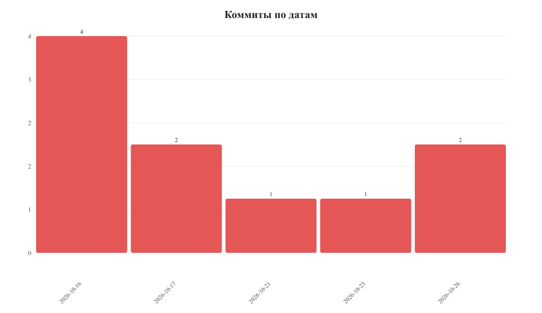
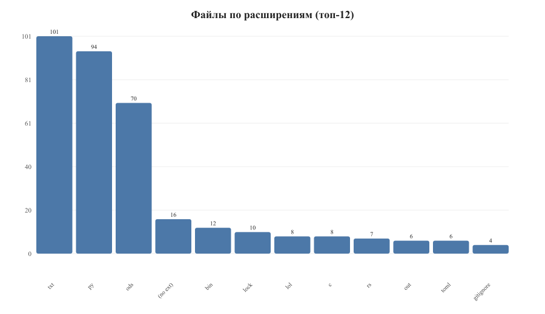
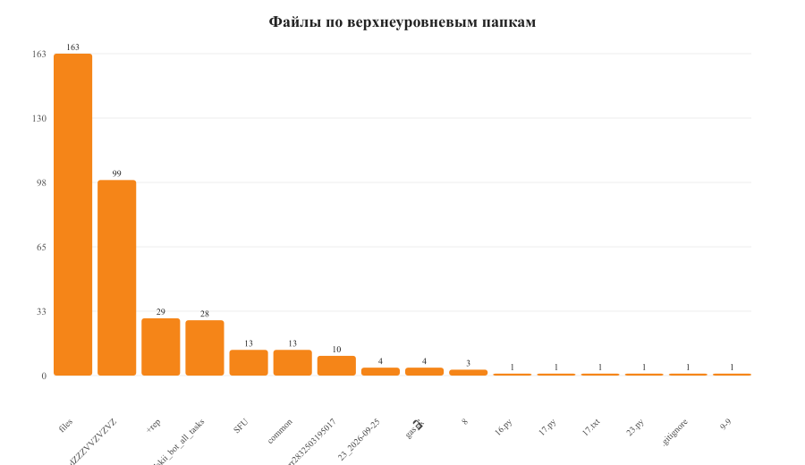
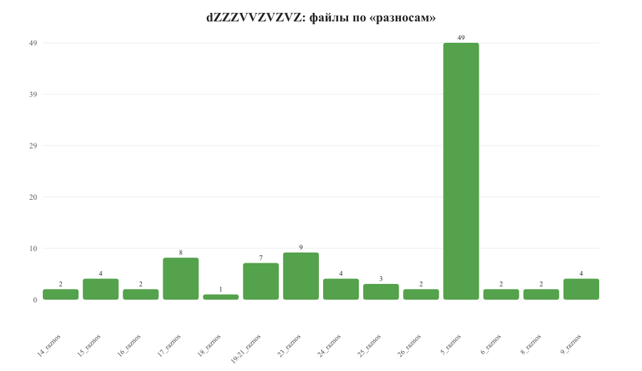
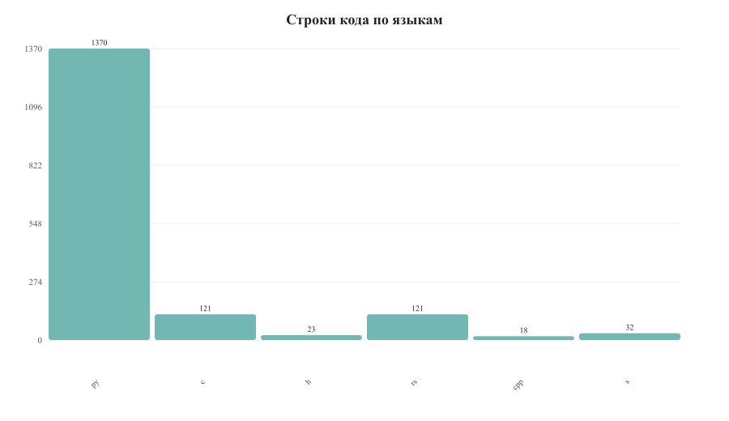
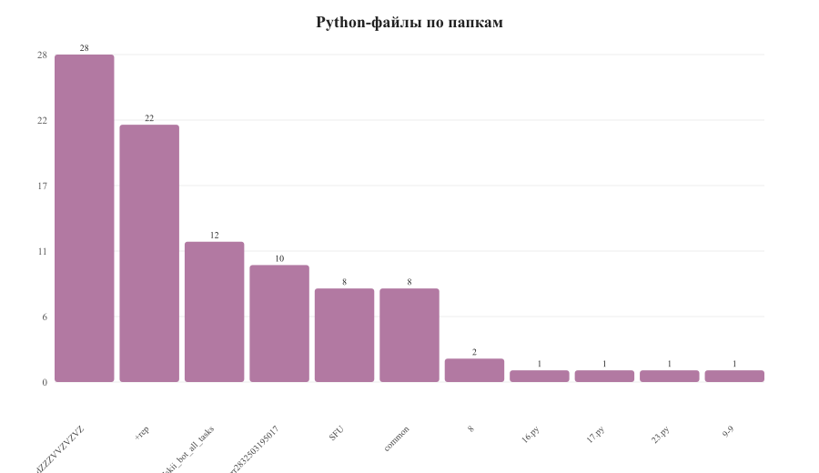

# Статистика репозитория project-bot

Дата отчёта: 2026-10-27

## Общие цифры

| Показатель | Значение |
|---|---|
| Коммитов | 10 |
| Файлов всего (без .git) | 372 |
| Tracked файлов | 308 |
| Untracked файлов | 13 |
| Строк кода (py/rs/c/cpp/s/h) | ~1665 |
| Python-файлов | 94 |
| Rust-файлов | 7 |
| C-файлов | 8 |

## Активность по коммитам

| Дата | Коммитов |
|---|---|
| 2026-10-16 | 4 |
| 2026-10-17 | 2 |
| 2026-10-21 | 1 |
| 2026-10-23 | 1 |
| 2026-10-26 | 2 |

## Файлы по расширениям (топ-12)

Топ: `txt` (101), `py` (94), `ods` (70), без расширения (16), `bin` (12), `lock` (10), `lol` (8), `c` (8), `rs` (7), `out` (6), `toml` (6), `gitignore` (4).

## Файлы по верхнеуровневым папкам

| Папка | Файлов |
|---|---|
| files | 163 |
| dZZZVVZVZVZ | 99 |
| +rep | 29 |
| adskii_bot_all_tasks | 28 |
| SFU | 13 |
| common | 13 |
| brrrr2832503195017 | 10 |
| 23_2026-09-25 | 4 |
| gas⛽ | 4 |
| 8 | 3 |
| 9-9 | 1 |

## dZZZVVZVZVZ: файлы по «разносам»

| Разнос | Файлов |
|---|---|
| 5_raznos | 49 |
| 23_raznos | 9 |
| 17_raznos | 8 |
| 19-21_raznos | 7 |
| 9_raznos | 4 |
| 15_raznos | 4 |
| 24_raznos | 4 |
| 25_raznos | 3 |
| 6_raznos | 2 |
| 8_raznos | 2 |
| 14_raznos | 2 |
| 16_raznos | 2 |
| 26_raznos | 2 |
| 18_raznos | 1 |

## Строки кода по языкам

| Язык | Файлов | Строк |
|---|---|---|
| Python | 94 | 1370 |
| C | 8 | 121 |
| Rust | 7 | 121 |
| Assembly (s) | 2 | 32 |
| C++ | 1 | 18 |
| Header (h) | 1 | 23 |

## Python-файлы по папкам

## Вывод

Работа велась активно с 16 по 26 октября: 10 коммитов, ~370 файлов, ~1.7k строк кода. Основной объём — Python-задачи (94 файла) и таблицы/варианты (ods/txt). Самый большой кластер — `dZZZVVZVZVZ` (99 файлов), особенно `5_raznos` (49 файлов). Также есть Rust/C задачи и наборы задач в `+rep`, `adskii_bot_all_tasks`, `SFU`, `common`.